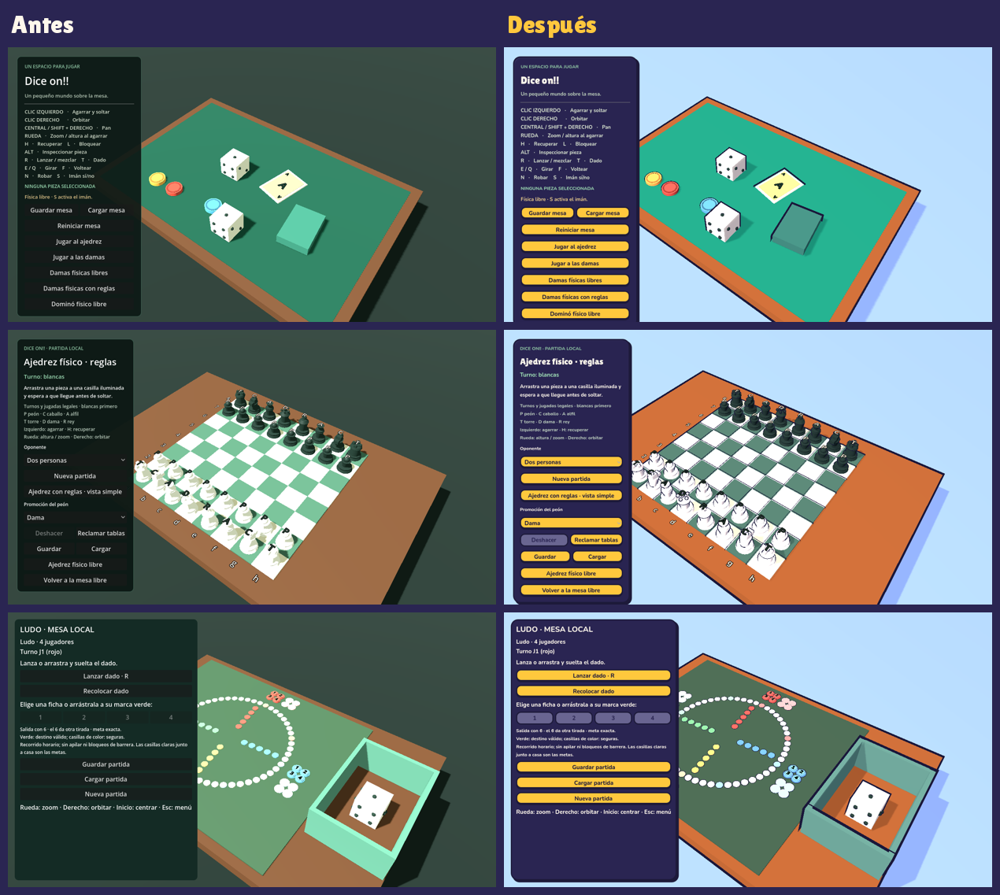
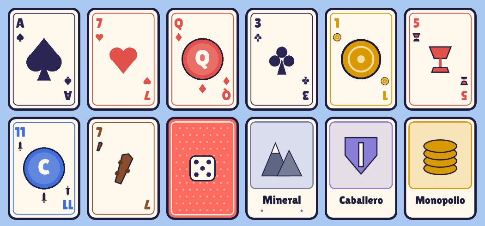
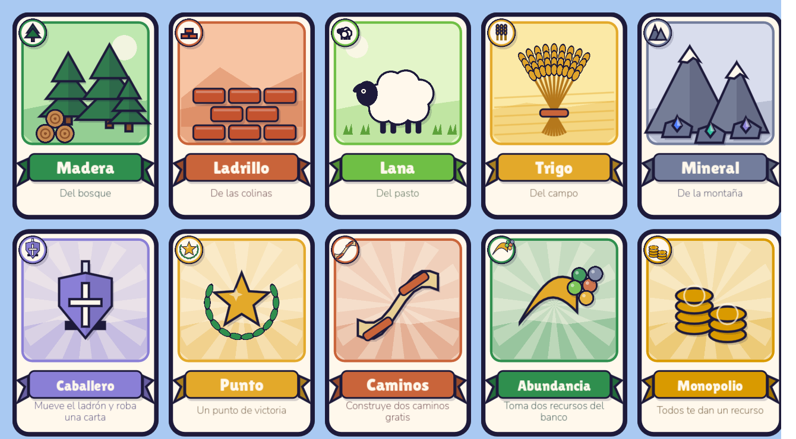
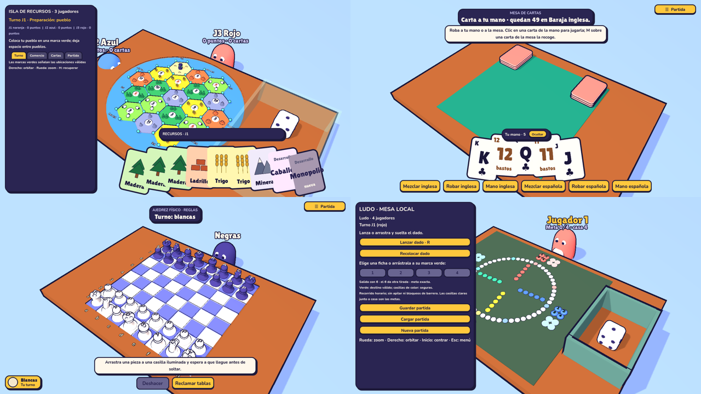

# Biblia de arte · Dice on!!

**Dirección:** cartoon de mesa. Colores saturados, formas redondeadas, contornos de tinta gruesos y animaciones con rebote. El objetivo es que una captura se reconozca a primera vista y que el juego vaya fluido en portátiles con gráficos integrados.

## Paleta

La fuente de verdad son las constantes de [`scripts/style/ToonStyle.gd`](../scripts/style/ToonStyle.gd). Si cambia un color, se cambia allí y aquí.

| Token | Color | Uso |
| --- | --- | --- |
| `INK` | `#1d1a3a` | Contornos, bordes de interfaz, texto sobre fondos claros |
| `SKY` | `#a9c9f2` | Fondo de todas las escenas |
| `FLOOR` | `#7c98cf` | Suelo bajo la mesa |
| `WOOD` | `#8a4f2a` | Madera de la mesa |
| `FELT` | `#1e7a5f` | Tapete |
| `PANEL` | `#2a2552` | Paneles de interfaz |
| `PAPER` | `#fff8ec` | Texto sobre paneles, campos, botones secundarios |
| `SUN` | `#ffc83d` | Botones principales, pestaña activa, acentos |
| `SUN_LIGHT` | `#ffd96e` | Botón al pasar el ratón |
| `LAVENDER` | `#c9c5ef` | Texto secundario sobre paneles |
| `MUTED` | `#8b87b3` | Controles desactivados |

Luz: sol cálido `#fff1d9` (energía 0,85) y luz ambiente lavanda `#c7c9ff` (0,5). La cara en sombra queda en torno a la mitad del color propio: contraste de dibujo animado sin negros.

**Reglas de color**
- Nunca transmitir información solo con color: los jugadores y las fichas llevan número o letra (ya se hace en ludo, ajedrez y la isla).
- Los colores de jugador conservan sus nombres (rojo, azul, naranja, blanco…) para que los textos de turno sigan siendo correctos.
- Evitar el negro puro y el blanco puro en superficies grandes: queman la imagen con la iluminación por bandas.

## Iluminación y sombreado

- Materiales opacos: difuso y especular **toon** de Godot (`DIFFUSE_TOON`, `SPECULAR_TOON`), rugosidad entre 0,45 y 0,8, sin metal.
- Sin tonemapping (`linear`): los colores saturados no se apagan.
- Sombras al 55 % de opacidad y con más sesgo, para evitar rayas de "acné" sobre superficies curvas.
- Materiales transparentes o sin iluminación (resaltados, vistas previas, paredes de cristal, marcas) **no** se tocan.

## Contornos

Casco invertido ([`shaders/toon_outline.gdshader`](../shaders/toon_outline.gdshader)): la malla se dibuja inflada y por detrás en color `INK`. Funciona en el renderizador Compatibility.

- Grosor proporcional al tamaño de la malla: 3,6 % de su mayor dimensión, entre 0,8 y 3 cm. Un dado de 0,5 m lleva unos 1,8 cm.
- Dirección de inflado según la forma: cajas hacia las esquinas, cilindros rectos desde el centro, conos y mallas generadas según la normal (si no, el contorno atraviesa las piezas vecinas).
- Sin contorno: láminas de menos de 1,2 cm (marcas, separadores, casillas del imán), tapetes grandes y finos, planos y el suelo.

## Tipografía

| Rol | Fuente | Dónde |
| --- | --- | --- |
| Titulares | **Lilita One** | Etiquetas de 22 px o más |
| Texto e interfaz | **Nunito** peso 750 | Todo lo demás |

Ambas con licencia SIL Open Font License, incluida en `assets/fonts/`.

## Interfaz

- Paneles `PANEL` con borde `INK` de 3 px, esquinas de 18 px y sombra dura desplazada 5 px.
- Botones principales `SUN` con texto `INK`, borde de 3 px y 6 px abajo para dar volumen; al pulsar, el borde inferior baja a 3 px y el texto se hunde.
- Botones del menú principal en `PAPER`, con el mismo volumen.
- Foco de teclado: anillo `PAPER` de 3 px alrededor del control.

## Animación ("juice")

- Al agarrar una pieza, su malla se estira hacia arriba (×1,14 en altura) y vuelve con rebote.
- Al soltarla, se aplasta (×0,84) y rebota.
- Solo cambia la malla visual: el colisionador y la física no se deforman.
- **Reducir animaciones** en el menú principal desactiva los rebotes; se guarda en `user://diceon_controls.cfg`.

## Cómo se aplica

`ToonStyle` es un autoload que actúa sobre cada nodo al entrar en el árbol, así que las escenas no necesitan cambios para recibir el estilo. Modifica los materiales en su sitio, sin sustituirlos, para que los scripts que cambian colores sigan funcionando. Si un script cambia la malla de una pieza en tiempo de ejecución, puede llamar a `ToonStyle.restyle(mesh_instance)`.

Para revisar el aspecto sin abrir el editor: `tools/shots.sh <carpeta> [godot]` captura las mesas principales con un renderizador real (en Linux sin pantalla usa `xvfb-run`).

## Piezas

Todas las piezas comparten un kit de formas ([`scripts/style/PieceKit.gd`](../scripts/style/PieceKit.gd)): cajas y losas redondeadas, discos con bisel, perfiles torneados y gotas de tinta. Los colores salen de [`scripts/style/Palette.gd`](../scripts/style/Palette.gd).

- **Dados y dominó:** cuerpo crema redondeado y puntos de tinta.
- **Cartas de mesa:** losa de canto grueso y esquinas muy redondeadas, anverso crema y reverso coral.
- **Ajedrez y damas:** dos bandos, crema y violeta; tablero crema y añil.
- **Isla:** el pueblo es una casita con tejado a dos aguas y puerta. La ciudad es una casa ancha con una torre de tejado en punta, para que se distinga del pueblo por la silueta. El camino es un tablón y el ladrón, una figura oscura con ojos. Los jugadores son naranja, azul, rojo y blanco.
- **Casillas de la isla:** prismas hexagonales en 3D sobre un mar azul, con paisaje en miniatura (árboles, colinas con ladrillos, ovejas, trigo, montañas nevadas y cactus en el desierto) y una ficha de número con puntos de probabilidad (6 y 8 en rojo). El paisaje se coloca lejos de esquinas y lados para no tapar pueblos ni caminos. Ya no se usan fotografías.

## Arte de las cartas

Simple y legible a cualquier tamaño ([`scripts/cards/CardArt.gd`](../scripts/cards/CardArt.gd)): todas las cartas se dibujan con formas planas y contorno de tinta y se guardan como textura compartida, así que se ven igual en la mano y sobre la mesa.

- **Estilo vectorial:** formas planas con contorno de tinta, sombras planas desplazadas (sin degradados) y un pequeño brillo en los palos redondeados. Se dibujan al doble de resolución para verse nítidas de cerca.
- **Anverso:** crema, con un marco fino del color del palo y el índice (valor y palo) en dos esquinas. Los números del 2 al 10 siguen la distribución clásica de palos; en la baraja francesa los de la mitad inferior van invertidos y en la española no. El as lleva un palo grande sobre un círculo suave.
- **Figuras:** un arco del color del palo con su emblema y una cinta con la letra: corona (K, rey), tiara (Q), gorro con pluma (J, sota) y cabeza de caballo (caballo).
- **Palos dibujados**, sin depender de la fuente: picas y tréboles en tinta, corazones y diamantes en coral; oros (moneda dorada), copas (cáliz coral), espadas (azul) y bastos (garrote de madera).
- **Reverso:** coral, con rombos geométricos en dos tonos, doble marco crema y un medallón con el dado de Dice on!! en el centro. Es también la cara de arriba de los mazos.
- **Isla:** las cartas de recurso llevan una escena vectorial en una ventana a dos tonos: bosque con pinos y troncos, muro de ladrillos sobre colinas, oveja en el pasto, gavilla de trigo en el campo y montañas nevadas con gemas. Debajo, el nombre en una cinta y el terreno de origen. Las cartas de desarrollo llevan su emblema sobre rayos suaves y una frase con lo que hacen («Mueve el ladrón y roba una carta»…). Todas tienen una **insignia en la esquina superior izquierda** para reconocerlas en el abanico de la mano aunque solo asome el borde. Las de desarrollo, un emblema sobre un círculo crema: escudo (caballero), estrella (punto), caminos cruzados, destellos (abundancia) y monedas (monopolio).

`tools/card_sheet.gd` genera una hoja de muestras para revisar el arte.

## Cartas en la mano

Las cartas que tiene un jugador se ven **en 3D, en abanico y sujetas delante de la cámara** ([`scripts/cards/Hand3D.gd`](../scripts/cards/Hand3D.gd)). Se dibujan en una capa propia, así que nunca atraviesan la mesa. Al pasar el ratón, la carta se levanta; con un clic se usa.

- **Mesa de cartas:** «Mano inglesa» y «Mano española» roban directamente a la mano, **M** sobre una carta de la mesa la recoge y un clic en la mano la juega boca arriba. «Ocultar» pone la mano de espaldas para pasar el equipo. La mano se guarda con la partida.
- **Isla:** cada recurso es una carta suelta (3 maderas = 3 cartas), agrupadas por tipo, seguidas de las cartas de desarrollo. Las recién compradas salen más oscuras y con la marca «nueva». En abundancia y monopolio la mano muestra una carta de cada recurso para elegir.
- Iconos de recurso dibujados con formas planas y contorno de tinta ([`ResourceIcon.gd`](../scripts/island/ResourceIcon.gd)).

## Información en la mesa

El panel lateral se sustituye por información en la propia mesa ([`scripts/ui/TableHud.gd`](../scripts/ui/TableHud.gd)):

- **Jugadores sentados** alrededor de la mesa como personajes de su color ([`TableSeats.gd`](../scripts/table/TableSeats.gd)), con nombre y estado encima: puntos y cartas en la isla, fichas en la meta en el ludo y fichas restantes en el dominó. El jugador con el turno salta y tiene un aro amarillo. Los bots llevan antena y ojos de pantalla.
- Los jugadores **del lado de la cámara** no se dibujan en 3D, porque taparían la mesa. Aparecen como ficha abajo a la izquierda, con «Tu turno» cuando les toca.
- **Cartel de turno** arriba al centro y **pista del momento** justo debajo.
- **Barra de acciones** abajo y **cajón «Partida»** con guardar, cargar, cambiar de modo y ajustes.
- La isla y el ludo conservan su panel de acciones, ya con la paleta, y tienen a los jugadores sentados a la mesa.

## Habitación

La mesa está en una habitación acogedora ([`scripts/style/RoomDecor.gd`](../scripts/style/RoomDecor.gd)), que se añade sola a cada escena con suelo. Tiene suelo de tablones de madera, una alfombra lavanda bajo la mesa, dos paredes con zócalo, una ventana con una nube, una estantería con libros de colores y una planta. Las paredes son de una sola cara: si la cámara gira por detrás, desaparecen en vez de tapar la mesa.

## Sonido

Efectos cortos generados por código ([`scripts/audio/Sfx.gd`](../scripts/audio/Sfx.gd)), sin archivos de audio:

- **Agarrar:** pop ascendente.
- **Soltar:** golpe de madera.
- **Lanzar dados:** tres choques de plástico.
- **Resultado del dado:** pop.
- **Cartas:** soplido de papel.
- **Botones:** clic.
- **Cambio de turno:** dos notas.

Cada reproducción varía un poco el tono para que no suene repetida. «Efectos de sonido» en el menú los apaga y se guarda en el equipo.

## Dados

Al quedarse quieto un dado, su número salta encima con un rebote y salen chispas de colores de la paleta. Con «Reducir animaciones» se muestra el número, pero sin salto ni chispas.

## Pendiente en la fase 1

- Pasar las acciones de la isla y el ludo a la barra inferior y al cajón, como en las demás mesas.
- Variante de paleta para daltonismo.
- Música ambiental tranquila y volúmenes separados.
- Test de lectura con 5 personas y medición de FPS en un portátil con gráficos integrados.
