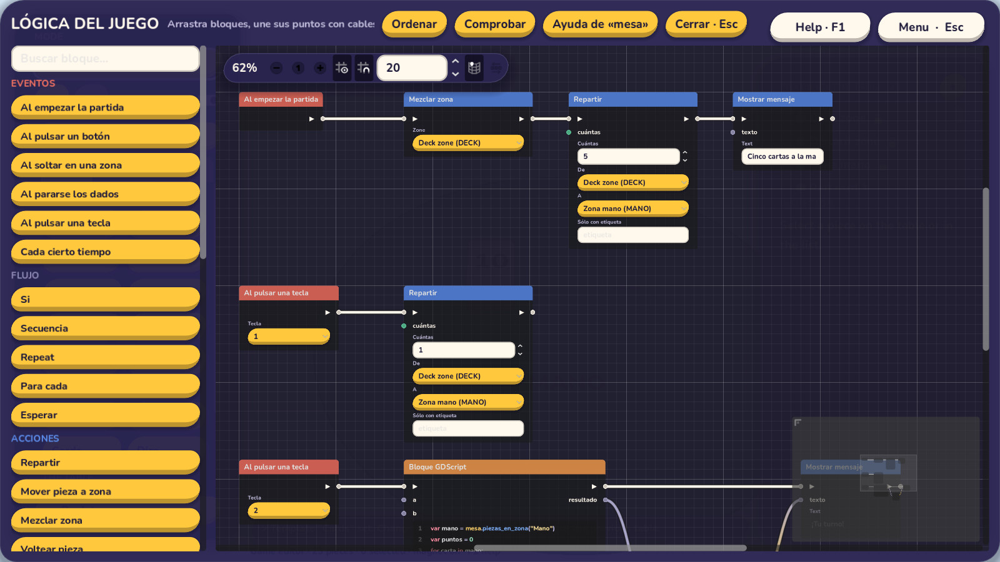

# La lógica del juego: blueprints con bloques GDScript

En el editor de juegos, **🧩 Lógica del juego…** abre un lienzo de bloques (como los
blueprints de Unreal) para dar reglas al juego sin programar, y bloques **GDScript** para
lo que haga falta programar. Es la alternativa de Tablerama al Lua de Tabletop Simulator.



## Cómo se usa

- Arrastra bloques desde la paleta de la izquierda (o **clic derecho** en el lienzo).
- Une un punto de **salida** (derecha) con uno de **entrada** (izquierda). Los colores dicen
  el tipo: blanco ▶ flujo, verde número, rojo sí/no, amarillo texto, azul pieza, morado
  lista, gris cualquiera. Sólo se unen tipos que encajan (un número sí entra en un texto).
- Una entrada sin cable usa el valor escrito en el bloque; con cable, ese valor se apaga.
- **Supr** borra, **Ctrl+D** duplica (con los cables entre lo duplicado), **Ordenar**
  coloca los bloques solos, **Comprobar** revisa el código. Todo se deshace con Ctrl+Z.
- La lógica se guarda con la mesa y viaja dentro del archivo `.tablerama` exportado.
- Al pulsar **Probar la mesa**, la lógica funciona; al volver a editar, se para.

## Bloques

| Categoría | Bloques |
|---|---|
| **Eventos** | Al empezar la partida · Al pulsar un botón (de la interfaz) · Al soltar en una zona (da la pieza) · Al pararse los dados (da el total y los valores) · Al pulsar una tecla (1–9) · Cada cierto tiempo |
| **Flujo** | Si (sí/no) · Secuencia (1, 2, 3) · Repetir N veces (da la vuelta) · Para cada (recorre una lista) · Esperar segundos |
| **Acciones** | Repartir N de una zona a otra (con etiqueta opcional) · Mover pieza a zona · Mezclar zona · Voltear pieza · Voltear zona · Tirar los dados · Sumar al contador · Poner el contador a · Mostrar mensaje · Mostrar u ocultar (interfaz) · Guardar variable |
| **Datos** | Número · Texto · Piezas en zona · Contar · Al azar · Operar (+ − × ÷ resto mín máx) · Comparar · Y/O/No · Leer variable · Valor del contador · Última tirada · Unir texto · ¿Tiene etiqueta? · Nombre de la pieza |
| **GDScript** | **Bloque GDScript** (con flujo: hace cosas y devuelve un valor) · **Calcular con GDScript** (sólo calcula) |

Las **etiquetas** de las piezas (inspector: «rojo, carta, jugador1…») sirven para elegir
piezas en «Repartir», «Piezas en zona» o desde el código.

## Bloques GDScript

Reciben dos entradas, `a` y `b`, devuelven un valor con `return` y manejan la mesa con
`mesa`:

```gdscript
var mano = mesa.piezas_en_zona("Mano")
var puntos = 0
for carta in mano:
	puntos += int(mesa.texto_de(carta))
mesa.poner("Puntos", puntos)
return puntos
```

`mesa` ofrece: `piezas()`, `piezas_en_zona(zona, etiqueta)`, `piezas_con_etiqueta(e)`,
`nombre(p)`, `etiquetas(p)`, `tiene_etiqueta(p, e)`, `texto_de(p)`, `escribir(p, texto)`,
`color(p)`, `zona_de(p)`, `zonas()`, `mover(p, zona)`, `repartir(n, de, a)`, `mezclar(zona)`,
`voltear(p)`, `tirar_dados()`, `ultima_tirada()`, `contador(c)`, `sumar(c, n)`, `poner(c, v)`,
`mostrar(elemento, visible)`, `mensaje(texto)`, `variable(nombre)`, `guardar(nombre, valor)`,
`rango(n)` y `azar(desde, hasta)`. Las zonas y los contadores se nombran por su nombre o su
texto; las piezas son ids. El botón **Ayuda de «mesa»** lo muestra dentro del editor.

### Seguridad

Los juegos se comparten como archivos, así que el código de un juego descargado no puede
tocar nada fuera de la mesa:

- Antes de compilar, cada nombre se comprueba contra una lista cerrada: `mesa`, `a`, `b`,
  variables propias, funciones de cálculo (`abs`, `min`, `randi_range`, `str`…) y métodos de
  listas, textos y diccionarios. `OS`, `FileAccess`, `load`, `get_tree`, `call`, `$`,
  `self`, `func`, `while`, `await` y cualquier otro nombre se rechazan con un aviso y la
  línea.
- Los bucles se hacen con `for` sobre listas o sobre `mesa.rango(n)`, que comparte un límite
  de 20 000 vueltas por ejecución; la lógica de bloques se para a los 20 000 pasos o a los
  300 bloques encadenados (un círculo de cables no cuelga el juego).
- La API `mesa` no guarda referencias: el código no puede llegar al editor ni a la escena.
- Al importar un juego con código, el editor lo avisa.

## Ejemplos incluidos

- **Plantilla Cartas**: al empezar, mezcla el mazo y reparte 5 a la mano; la tecla 1 roba.
- **Plantilla Dados**: al pararse los dados, un bloque «Calcular con GDScript» decide el
  mensaje según el total.
