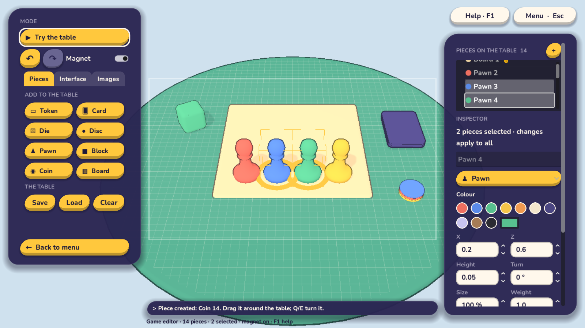
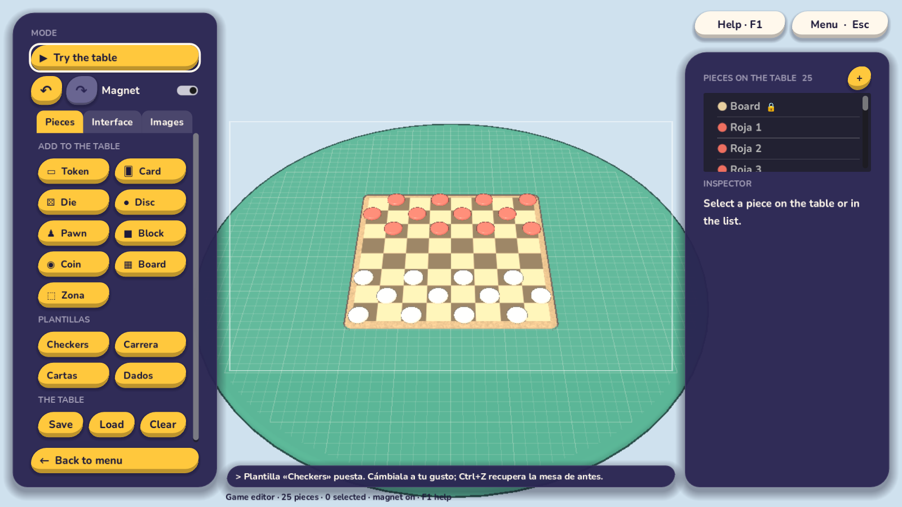
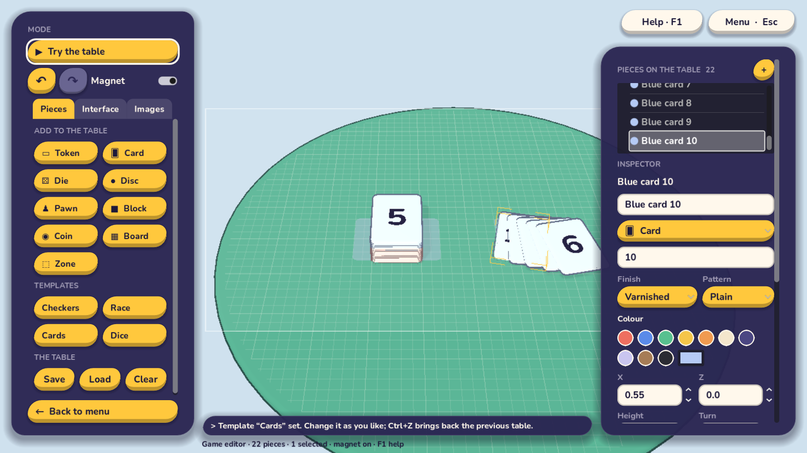
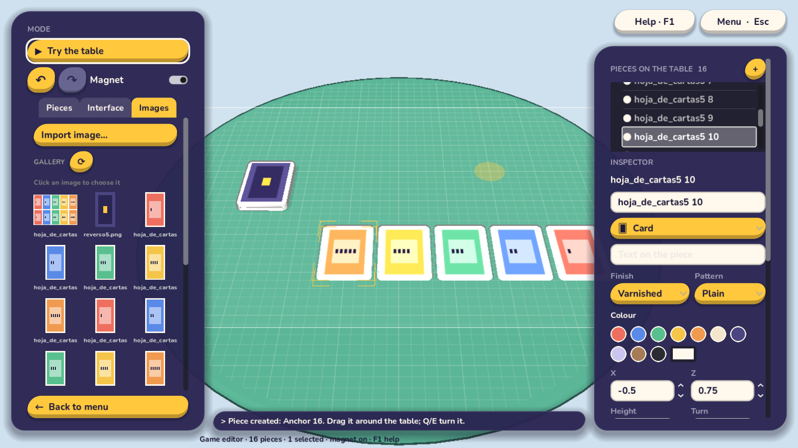
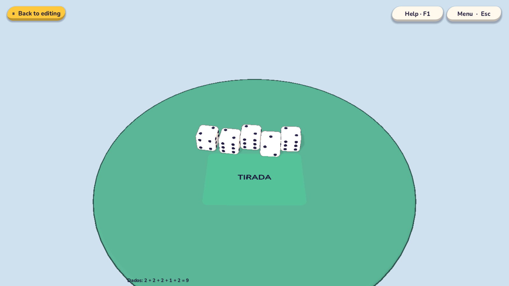

# Montar la mesa de tu juego (editor de juegos)

En el editor de juegos (menú → «Crear juegos») la mesa verde es tu juego: pones piezas,
las colocas, las pintas y las pruebas con física de verdad.

## Empezar con una plantilla

En la pestaña **Piezas**, **Plantillas** pone una mesa de partida lista para cambiar:

| Plantilla | Qué trae |
|---|---|
| **Damas** | Tablero de madera de 8×8 con dibujo de ajedrez y 24 fichas en su sitio |
| **Carrera** | Tablero de recorrido con esquinas de colores, 4 peones y un dado |
| **Cartas** | Mazo de 20 cartas numeradas (dos colores) sobre una zona «Mazo», y una zona «Descarte» |
| **Dados** | Cinco dados y una zona «Tirada» |

La plantilla sustituye a la mesa actual; **Ctrl+Z** recupera la de antes.

## Poner piezas

En la pestaña **Piezas** del panel izquierdo hay diez formas: **ficha, carta, dado, disco,
peón, bloque, moneda, tablero, zona y anclaje**. Cada pulsación pone una pieza en un hueco libre cerca del
centro. Si debajo hay otra pieza (un tablero, por ejemplo) la nueva se posa encima.

Los **dados** traen sus puntos (las caras opuestas suman 7). Las **zonas** son marcas
translúcidas con un texto (mazo, descarte, mano…): no chocan ni sostienen piezas, y las
piezas soltadas encima se posan en la mesa.

Los **anclajes** son puntos a los que se pegan las piezas que se sueltan cerca, tomando
además su giro (como los *snap points* de Tabletop Simulator). Sólo se ven al editar; al
probar siguen funcionando. Una zona puede marcarse como **«Mezclar lo de dentro al probar»**:
al empezar la prueba, las piezas que tiene encima se barajan de sitio.

El **tablero**, las zonas y los anclajes nacen **fijos**: no se arrastra por accidente y al probar no se mueve. Cualquier
pieza puede fijarse o soltarse con la casilla «Fija» del inspector.

## Seleccionar

- **Clic** en una pieza la selecciona; **Ctrl o Mayús + clic** la añade o la quita.
- **Arrastrar en un hueco** dibuja un recuadro y selecciona lo que queda dentro.
- La **lista «Piezas en la mesa»** (arriba a la derecha) también selecciona, una o varias.
  Cada pieza lleva un punto de su color y un candado si está fija.
- **Ctrl+A** selecciona todo; **Esc** suelta la selección (y, sin selección, vuelve al menú).

Lo seleccionado se marca con un aro amarillo en la base y esquinas que se ven a través de
otras piezas; al pasar el ratón por encima de una pieza se marca en blanco.

## Mover, girar y cambiar

| Acción | Cómo |
|---|---|
| Mover | Arrastrar. Con el **imán** (G) cae en una cuadrícula de 10 cm; Mayús lo desactiva mientras arrastras. Las piezas se **apilan solas** al soltarlas encima de otra. |
| Copiar arrastrando | Alt + arrastrar |
| Mover un paso | Flechas (Mayús: 5 pasos), según se ve la mesa |
| Subir / bajar | RePág / AvPág |
| Girar | Q / E de 15 en 15 (Mayús: 5°), o la rueda mientras arrastras |
| Voltear | F (cartas boca abajo, fichas del revés) |
| Tamaño | + / − o el campo «Tamaño» (del 25 % al 400 %) |
| Duplicar | Ctrl+D o el botón «Duplicar» |
| Copiar y pegar | Ctrl+C / Ctrl+V |
| Quitar | Supr o el botón «Quitar» |

El **inspector** (derecha) cambia el nombre, la forma, el color (diez de la paleta u otro
cualquiera), la posición exacta (X, Z, altura), el giro, el tamaño y el peso. Con varias
piezas seleccionadas, los cambios van a todas. «Poner imagen» usa la imagen elegida en la
pestaña **Imágenes**; «Sin imagen» la quita.

Además, en el inspector:

- **Texto en la pieza**: un número o una palabra en la cara de arriba (cartas, fichas,
  zonas); el color de la letra se elige solo para que se lea.
- **Acabado**: mate, plástico, barnizado, metal o madera (con veta).
- **Dibujo** (piezas planas: tablero, carta, ficha, zona): liso, ajedrez, casillas, recorrido
  o cruces de go, con **2 a 19 casillas** por lado. El dibujo toma el color de la pieza.
- **Repetir en rejilla**: copias de la pieza en columnas y filas (por ejemplo, 8 × 2 peones).

Con varias piezas, **Ordenar la selección** ofrece:

- **En fila**: las alinea con un hueco entre ellas.
- **Apilar**: una encima de otra sobre la primera (mazos de cartas, torres de fichas).
- **Centrar**: lleva el grupo al centro de la mesa sin deshacer su forma.
- **Numerar**: escribe 1, 2, 3… de izquierda a derecha y de fondo a frente.
- **Mezclar**: baraja los sitios de las piezas entre ellas (un mazo, fichas ocultas).

## Modelos 3D y arrastrar archivos

- **Importar modelo 3D…** (pestaña Imágenes, o la forma «Modelo 3D») acepta **.glb** (con
  sus materiales y colores) y **.obj** (se pinta con el color, el acabado o la imagen de la
  pieza). El modelo se encaja para que su lado mayor mida 0,5 y apoye en la mesa; luego se
  cambia de tamaño, se apila y se usa como cualquier pieza. Se copia al juego y viaja dentro
  del `.tablerama` exportado.
- Se pueden **arrastrar archivos a la ventana**: las imágenes van a la galería, los modelos a
  la mesa y los juegos `.tablerama` se abren.

## Tipos de zona

En el inspector de una zona, **Tipo**:

- **Normal**: una marca con texto.
- **Mano**: lo que se suelta o se reparte ahí se coloca en fila, boca arriba y ordenado.
- **Oculta**: al probar, una tapa con «?» esconde lo de dentro; se puede meter la mano y
  sacar una pieza a ciegas, como de una bolsa.

Y la casilla **Mezclar lo de dentro al probar** vale para cualquier tipo.

## Mazos desde imágenes

En la pestaña **Imágenes**:

- **Importar imagen…** la añade a la galería; un clic en una miniatura la elige.
- **Mazo desde la hoja elegida**: una hoja con las cartas en rejilla (columnas × filas,
  y cuántas cartas tiene, como las hojas de Tabletop Simulator) se corta sola en un mazo,
  sin programas aparte. Cada carta queda como imagen propia en la galería.
- **Una carta por imagen**: un mazo con una carta por cada imagen de la galería.
- Con el mazo seleccionado, elige otra imagen y pulsa **Poner reverso** en el inspector:
  todas las cartas tienen dorso, que se ve al voltearlas (F).

Cada pieza tiene además una **descripción** (inspector) que se lee en la barra de abajo al
pasar el ratón, al editar y al probar.

## Deshacer, guardar y cargar

- **Ctrl+Z** deshace y **Ctrl+Y** (o Ctrl+Mayús+Z) rehace cualquier cambio de la mesa,
  también la selección que había. Teclear un número o girar varias veces seguidas se deshace
  de una vez. Los botones ↶ ↷ hacen lo mismo.
- **Guardar / Cargar** (pestaña Piezas, o **Ctrl+S**) conservan la mesa en este equipo.
  Un archivo dañado o con piezas imposibles se rechaza y la mesa actual no se toca.
- **Vaciar** quita todas las piezas; Ctrl+Z las recupera.
- **Exportar juego…** escribe un solo archivo `.tablerama` con la mesa, la interfaz y
  **todas las imágenes dentro**. **Importar juego…** lo abre en cualquier equipo: las
  imágenes vuelven a la galería y nada depende de enlaces a webs que se rompan. Un archivo
  dañado, con piezas imposibles o con rutas fuera del juego se rechaza sin tocar la mesa.

## Cámara

- **Botón derecho**: orbitar alrededor de la mesa.
- **Botón central** o **Mayús + derecho**: desplazar.
- **Rueda**: acercar y alejar.
- **C** o **doble clic**: enfocar la selección. **Inicio**: volver a la vista inicial.

**F1** muestra todos estos atajos dentro del editor.

## Lógica

Las reglas del juego se montan con bloques (blueprints) y bloques GDScript: ver
[EDITOR-LOGICA.md](EDITOR-LOGICA.md).

## Probar

«Probar la mesa» aparta los paneles: las piezas caen con física (las fijas se quedan) y la
interfaz diseñada funciona. Al probar:

- **Arrastrar** agarra una pieza, que flota sobre la mesa y empuja a las demás; al soltarla
  cae, y si el ratón aún se movía, sale lanzada. La rueda la gira.
- **R** (o doble clic en un dado) **tira los dados**: el agarrado o señalado, o todos. Cuando
  se paran, la barra de abajo dice qué ha salido («Dados: 3 + 5 = 8»).
- **F** voltea la pieza agarrada o señalada.
- Un borde invisible evita que lo lanzado se caiga; si algo se sale, vuelve a su sitio.
- **Esc** o «Volver a editar» devuelven cada pieza a donde la pusiste.

